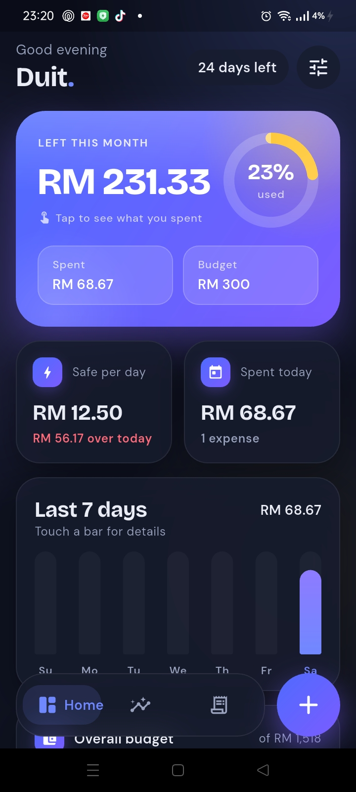
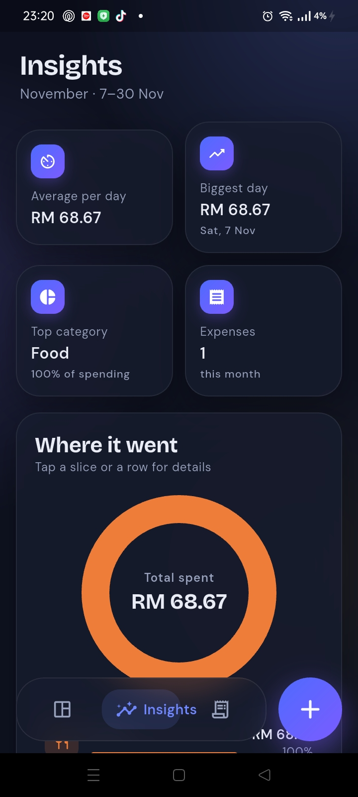
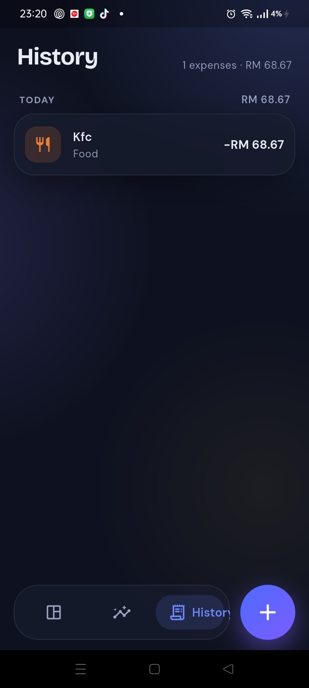

# Duit. — Personal Budget Tracker

A simple, offline budget tracker for Android, built with Flutter. Set a monthly budget, log spending in a few taps, and always know how much you can safely spend today.

<p align="center">
  
  
  
</p>

## Features

**Budgeting**
- Monthly budget plus an overall budget (a pot of money that runs down across months)
- Money left, percentage used, and **safe to spend per day** for the rest of the month
- Income (allowance, salary, freelance…) tops up the overall budget
- New months start automatically, carrying last month's budget over

**Tracking**
- Add an expense or income in a few taps: amount, category, date, optional note
- Pick any past date (Today, Yesterday, or a calendar)
- Edit, delete with undo, or swipe to delete
- History grouped by day with money in and out

**Insights**
- Interactive category donut chart (tap a slice for details)
- Daily spending bars against a daily budget line
- Spending pace chart: running total vs. an even pace to your budget
- Average per day, biggest day, top category

**Android home screen widget**
- Today's spending, money left this month, and a progress bar
- Quick-add button that opens the add screen
- Updates whenever an entry is added, edited or deleted

**Design**
- Glossy gradient UI with glass cards, a frosted floating tab bar and smooth animations
- Light and dark mode, haptic feedback, respects reduce-motion

## Tech stack

| Area | Choice |
| --- | --- |
| Framework | Flutter (Dart) |
| State management | Riverpod |
| Local database | Drift (SQLite) |
| Charts | fl_chart |
| Home screen widget | home_widget + Kotlin `AppWidgetProvider` |
| Fonts | Bricolage Grotesque, DM Sans (bundled, works offline) |

No login, no backend: all data stays on the device.

## Architecture

```
UI (features/*)              Screens, charts, widgets
   │  watches
State (Riverpod providers)   Combines data into a budget summary
   │  uses
Domain (domain/*)            Plain Dart models + budget/chart math (unit tested)
   │  through
Data (repositories)          Interfaces + Drift implementations
   │
Storage (Drift → SQLite)     expenses, incomes, categories, monthly_budgets, app_settings
```

- **Reactive:** Drift streams → Riverpod → UI. One database change updates the dashboard, charts, history and the home screen widget together.
- **Repository pattern:** screens never touch SQLite directly, so cloud sync can be added later without changing the UI.
- **Money in cents:** amounts are stored as integers, so totals are always exact.
- **Versioned migrations:** schema upgrades keep existing user data.

```
lib/
├── core/        money & date helpers, theme, shared widgets
├── domain/      models, budget math, insights math
├── data/        Drift tables, database, repositories
├── features/    setup, dashboard, insights, expenses, settings, home shell
└── home_widget/ syncs data to the Android widget
android/…/DuitWidgetProvider.kt   draws the home screen widget
test/            unit tests for the budget and chart math
```

## Getting started

Requirements: Flutter (stable), Android Studio with the Android SDK.

```bash
git clone https://github.com/<your-username>/duit.git
cd duit
flutter pub get
dart run build_runner build --delete-conflicting-outputs   # generates the database code
flutter test
flutter run                                                # or: flutter build apk --release --split-per-abi
```

A full beginner guide for Windows is in [docs/SETUP.md](docs/SETUP.md).

## Roadmap

- Custom categories
- Recurring expenses
- Search and filters in history
- CSV export and backup/restore
- Daily reminder notification

## License

[MIT](LICENSE)
